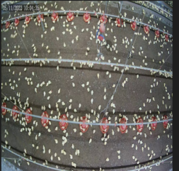
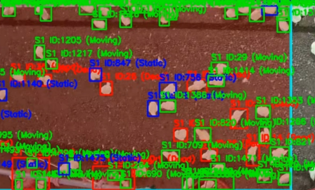
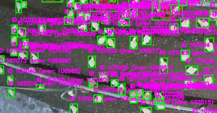
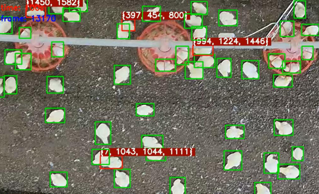
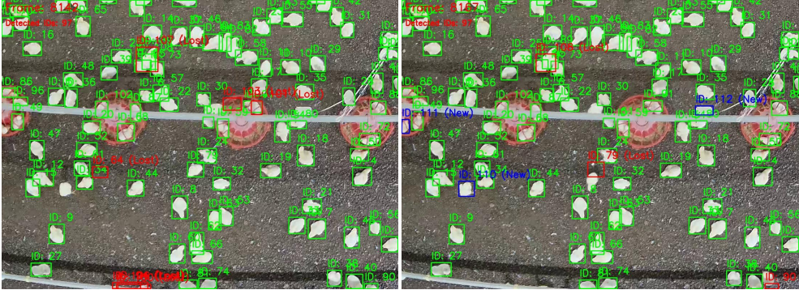
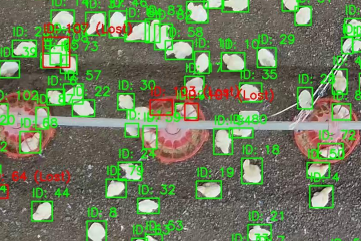
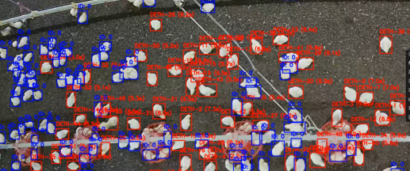
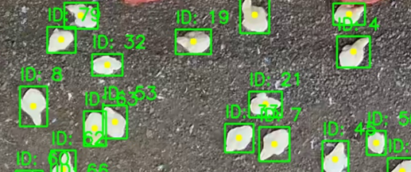
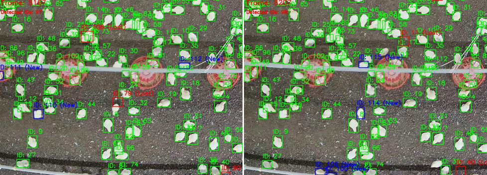
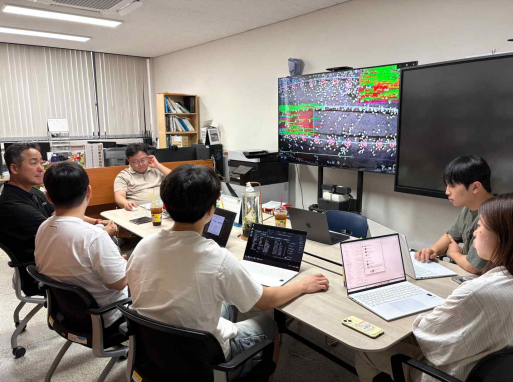

> **한 줄 요약**  
> "CCTV 영상 기반 닭 객체 탐지 및 실시간 ID 추적 알고리즘을 설계하고, 연산 복잡도($O(n^2) \to O(m \times k)$) 및 ID 폭발 문제를 개선하여 농장 폐사체 자동 판별 시스템 구축"

---

## 1. 문제의 시작: "죽은 닭을 학습시키면 되는 거 아닌가요?"

처음 기획은 단순했다. 약 500평 규모의 대형 육계 농장에서는 매일 수만 마리의 닭이 사육되는데, 조류독감 같은 전염병 예방을 위해 작업자가 하루에도 몇 번씩 축사를 돌며 폐사체를 직접 찾아내 수거해야 한다. 작업자의 피로도도 크고 방역 위험도 높으니, 천장에 달린 CCTV 영상에서 YOLO로 폐사체를 디텍션해 위치를 알려주면 끝날 문제라고 생각했다.

하지만 기업 멘토와의 첫 미팅에서 이 초기 가설은 보기 좋게 깨졌다.

1. **외형의 다양성과 미탐지(False Negative)의 위험**  
   폐사체의 대표적인 특징은 다리를 뻗고 누워있는 자세지만, 실제 현장에서는 모가지가 꺾여 있거나, 엎드려 있거나, 다른 닭에 반쯤 깔려 있는 등 형태가 천차만별이다. 특정 폐사체 형태만 라벨링해서 학습시키면, 모델은 학습 데이터와 조금만 다른 형태의 폐사체가 나와도 그냥 지나치게 된다.
2. **해상도와 스케일의 한계**  
   어린 병아리 단계에서는 천장 카메라 기준으로 크기가 너무 작아 팔다리 형태를 육안으로도 구분하기 힘들다.
3. **현장에서 더 치명적인 것은 오탐지(False Positive)**  
   멘토님이 강조한 현실적인 조언은 *"100마리 중 80마리만 찾아도 현장에서는 충분히 도움이 되지만, 멀쩡히 살아있는 닭을 죽었다고 잘못 짚어내는 오탐지가 잦으면 농장주는 시스템을 아예 꺼버린다"*는 것이었다.

결국 접근법을 완전히 바꿨다.  
**"폐사체의 외형을 찾으려 하지 말고, 살아있는 닭 전체를 추적하다가 '일정 시간 동안 전혀 움직이지 않는 객체'를 폐사체로 판별하자."**

---

## 2. 전체 파이프라인 설계

시스템의 구조는 크게 3단계로 정의했다.

1. **Detection (YOLO):** 천장 탑뷰(Top-view) 영상에서 모든 닭 객체를 바운딩 박스로 탐지.
2. **Tracking & ID Management:** 프레임이 바뀌어도 동일한 닭에는 동일한 ID를 부여하여 개체별 이동 경로 추적.
3. **Status Classification (FSM):** 움직임 여부를 판단해 3단계 상태 머신으로 폐사 판별.
   - **초록색 (Moving):** 정상 활동 중인 닭
   - **파란색 (Static, 의심 구간):** 1분 ~ 4분 동안 제자리에 멈춰 있는 닭
   - **빨간색 (Dead, 사망 판정):** 4분 이상 전혀 움직임이 없는 객체 $\to$ 최종 폐사체 확정 및 좌표 알림

구조는 명확해 보였지만, 영상 프레임을 돌리기 시작하자마자 수많은 문제들이 연쇄적으로 터져 나왔다.

---

## 3. 맞닥뜨린 기술적 문제와 트러블슈팅

### Trouble 1. 프레임마다 ID가 폭발하다 (Tracking 연속성 상실)

* **현상:**  
  수천 마리의 닭이 빽빽하게 모여 있는 환경에서 트래킹을 켜자, 몇 초 지나지 않아 화면이 온통 분홍색 글씨로 뒤덮였다. 동일한 닭인데도 한 프레임만 지나면 새로운 ID가 계속 발급되어 ID 번호가 1000단위, 2000단위로 기하급수적으로 치솟았다.

* **원인 분석:**  
  닭들이 먹이통 주변에 몰리거나 다른 닭 뒤로 지나가면서 일시적으로 가려지는 폐색(Occlusion)이 발생했다. 또한 조명 변화나 미세한 블러로 인해 모델의 Confidence가 순간적으로 낮아지면 디텍션이 풀렸다가 다시 잡히는데, 기존 트래커는 이를 '완전히 새로운 객체의 등장'으로 판단해 새 ID를 부여하고 있었다.

* **해결 방법:**  
  1. **파라미터 현실화:** 디텍션 연속성을 확보하기 위해 Frame Skip을 10에서 2로 줄여 프레임 간격 간극을 좁혔다. 또한 Confidence 임계값을 0.7에서 0.3으로, IoU 임계값을 0.7에서 0.5로 조정하여 순간적인 신뢰도 하락에도 박스가 유지되도록 완화했다.
  2. **임시 ID(-1)와 IoU 기반 ID 복구 메커니즘 도입:**  
     새로운 바운딩 박스가 잡히면 즉시 새 번호를 발급하지 않고 임시 ID인 `-1`을 부여했다. 그 후 이전 프레임의 탐지 목록(`last_detections`)과 현재 프레임의 탐지 목록(`new_detections`)의 IoU(교집합/합집합 비율)를 계산했다.  
     $$\text{IoU} = \frac{\text{Area of Overlap}}{\text{Area of Union}}$$  
     IoU가 0.5 이상이면 잠시 놓쳤던 동일 객체로 판단하여 이전 ID를 복구해주고, 0.5 미만일 때만 완전히 새로운 닭으로 인정해 새 ID를 발급했다.

---

### Trouble 2. $O(n^2)$의 늪과 ID 체인 탐색의 지연

* **현상:**  
  끊어진 ID들을 연결하기 위해 `{이전 ID: 새 ID}` 형태의 딕셔너리로 매핑을 관리했다. 하지만 프레임이 누적될수록 이전 ID의 '진짜 최종 ID'를 찾는 데 딜레이가 심해졌고, 화면 전체가 버벅거리기 시작했다.

* **원인 분석:**  
  초기 구조에서는 ID 2번이 11번이 되고, 다시 35번이 되었을 때 최종 ID를 찾으려면 체인을 따라 `while` 루프를 계속 돌아야 했다.
  ```python
  # 기존 방식: 체인을 따라 탐색하는 비효율 (최악의 경우 깊이만큼 순회)
  id_transitions = {2: 11, 11: 35, 35: 89}
  current_id = 2
  while current_id in id_transitions:
      current_id = id_transitions[current_id] # 2 -> 11 -> 35 -> 89
  final_id = current_id
  ```
  게다가 프레임마다 동일 객체인지 확인하기 위해 모든 객체 쌍을 전수 조사하고 있었기 때문에, 화면 내 객체 수가 $n$개일 때 비교 횟수가 $O(n^2)$으로 치솟았다.

* **해결 방법:**  
  1. **자료구조를 `{대표 ID: {ID 집합}}` 클러스터로 개편:**  
     체인 탐색 대신 대표 ID(가장 작은 ID 값)를 키로 두고, 해당 객체에 거쳐간 모든 ID를 하나의 집합(`set`)으로 묶었다.
     ```python
     # 개선 방식: 딕셔너리 키 조회로 O(1)에 모든 관계 파악
     id_clusters = {
         2: {2, 11, 35, 89},
         3: {3, 24, 76}
     }
     id_set = id_clusters[final_id]
     ```
     여기에 순서 보장을 위해 `collections.OrderedDict`를 적용해 상태를 안정화했다.
  2. **비교 대상 축소 ($O(n^2) \to O(m \times k)$):**  
     화면에 잘 붙어있는 수백 마리의 객체들까지 서로 비교할 필요가 전혀 없었다.  
     **'이전 프레임에서 사라진 ID 목록($m$개)'과 '현재 프레임에서 새로 나타난 ID 목록($k$개)'만 골라내어 비교**하도록 로직을 변경했다.  
     실제 환경에서는 $m, k \ll n$이므로, 연산량이 극적으로 감소하여 실시간 추적 속도를 확보할 수 있었다.

---

### Trouble 3. 자리를 뺏기는 ID (위치 고정 문제)

* **현상:**  
  객체의 중심점 간 유클리드 거리(`distance_threshold = 15`)를 기준으로 ID를 병합하도록 했을 때 이상한 버그가 발생했다. 64번 닭이 다른 곳으로 걸어가고, 그 빈자리에 34번 닭이 걸어 들어왔는데, 34번 닭이 64번 ID를 강제로 부여받는(ID를 빼앗는) 현상이었다.

* **원인 분석:**  
  알고리즘이 '개별 객체의 형태와 이동 궤적'을 추적한 것이 아니라, 단순히 '특정 좌표 반경'에 ID를 묶어두는 원리로 동작했기 때문이었다. 즉, 객체가 아니라 '자리(위치)'에 ID가 붙어버린 셈이었다.

* **해결 방법:**  
  단순 좌표 거리 기반 매핑을 걷어내고, 프레임 단위의 바운딩 박스 오버랩(IoU) 추적으로 일원화했다. 객체가 이동할 때 프레임 간 박스의 겹침 면적을 추적하여 ID가 위치가 아닌 '객체의 움직임'을 따라가도록 수정했다.

---

### Trouble 4. 밀집 구역의 박스 중복과 NMS 튜닝

* **현상:**  
  닭들이 모이통에 다닥다닥 붙어있을 때, 한 마리의 닭 몸체에 바운딩 박스가 2~3개씩 겹쳐서 생겨났다. 그 결과 한 마리 닭통에 2개의 ID가 붙고, 서로 간섭을 일으키며 트래커가 꼬였다.

* **원인 및 해결:**  
  탐지 모델의 바운딩 박스 후처리 과정에서 **NMS(Non-Maximum Suppression, 비최대 억제)** 임계값 설정이 현장 밀도와 맞지 않았다.  
  신뢰도 점수가 가장 높은 바운딩 박스를 기준으로, IoU 임계값을 0.5에서 0.4 수준으로 조절해가며 테스트했다. 임계값을 너무 높이면 한 마리에 여러 박스가 남고, 너무 낮추면 빽빽하게 붙어있는 서로 다른 두 마리를 하나로 뭉개버리는 딜레마가 있었다. 수차례의 그리드 서치 끝에 개체 간 분리도와 중복 제거율이 가장 균형을 이루는 최적 파라미터를 찾아 적용했다.

---

### Trouble 5. 가만히 있는데 왜 움직인다고 할까? (박스 Jittering 현상)

* **현상:**  
  폐사체 판별을 위해 '바운딩 박스 모서리 좌표가 변하지 않으면 정지 상태'로 두었더니, 실제로는 완전히 죽어있는 닭인데도 계속 '초록색(움직임)' 상태로 떴다.

* **원인 분석:**  
  영상 압축 노이즈, 조명 깜빡임, 주변 먼지 등으로 인해 YOLO가 예측하는 박스의 외곽선 좌표가 매 프레임 1~2픽셀씩 미세하게 떨리는 **지터링(Jittering)** 현상이 발생했다. 코드는 이 1픽셀의 진동을 '닭이 움직였다'고 판단한 것이다.

* **해결 방법:**  
  1. 박스 전체 좌표 대신 **중심점(Center Point) 좌표**를 추출했다.
  2. 중심점의 이동 거리가 일정 노이즈 반경(Threshold) 이내일 경우 위치 변화가 없는 것으로 필터링했다.
  3. 이를 기반으로 `움직임 없음 카운터(Static Timer)`를 누적하여, 1분 이상이면 파란색(의심), 4분 이상 지속되면 빨간색(폐사체 확정)으로 전환되는 3단계 상태 판별 로직을 완성했다.

---

## 4. 최종 결과 및 한계점

| 항목 | 초기 프로토타입 | 최종 구현 결과 |
| :--- | :--- | :--- |
| **판별 방식** | 폐사체 외형 직접 디텍션 | 전체 객체 추적 + 시간 기반 상태 판별 (초록/파랑/빨강) |
| **ID 안정성** | 폐색 발생 시 ID 무한 폭발 | IoU 기반 복구로 끊김 최소화, 대표 ID 집합 관리 |
| **연산 복잡도** | 전수 조사 $O(n^2)$ | 사라진 ID vs 새 ID 매칭 $O(m \times k)$ |
| **바운딩 박스 안정성**| 지터링으로 인한 오탐지 빈번 | 중심점 필터링 및 NMS 튜닝으로 안정화 |

### 솔직한 한계점 (Next Step)
1. **바운딩 박스 내부의 제자리 움직임 미감지**  
   현재 로직은 박스의 '중심점 이동'만 감지한다. 만약 닭이 이동하지 않고 제자리에 앉아 머리만 쪼거나 숨만 헐떡인다면, 중심점 좌표가 변하지 않아 'Static'으로 카운트될 위험이 있다. 향후 박스 내부 픽셀의 변화량(Optical Flow)을 함께 보는 하이브리드 판별 방식이 필요하다.
2. **장거리 이동 시 ID 단절**  
   닭이 갑자기 빠르게 뛰어서 이전 프레임 박스와의 IoU가 0이 되거나(79 -> 114), 화면 밖으로 완전히 나갔다 들어오면 새로운 ID를 부여받는다. 폐사체는 '움직이지 않는 객체'이므로 폐사체 탐지 자체에는 영향이 없지만, 개체별 생체 리듬 분석으로 확장하기 위해서는 칼만 필터(Kalman Filter)나 ByteTrack 같은 딥러닝 기반 다중 객체 추적기(MOT) 도입이 필요하다.

---

## 5. 마치며: 연구실 밖의 엔지니어링

이 프로젝트를 진행하며 배운 것?: **"가장 복잡한 모델보다 도메인 제약에 맞는 문제 정의가 우선"**이라는 것.

처음에는 더 거대한 최신 디텍터를 쓰거나 열화상 카메라를 달면 다 해결될 줄 알았다. 하지만 멘토링을 통해 *"열화상 카메라는 다중 객체 추적 시 단일 포인트 추적 제약 때문에 현장에 맞지 않는다"*, *"완벽한 탐지보다 살아있는 닭을 죽었다고 잘못 울리는 오탐지를 잡는 게 시스템의 생존 조건이다"* 같은 실무 피드백을 받으면서, 엔지니어의 역할은 모델의 크기를 키우는 게 아니라 현장의 제약 속에서 가장 견고한 알고리즘을 깎아내는 것임을 배웠다.

작은 파이썬 `set`의 순서 보장 문제부터 시작해, 알고리즘 복잡도를 줄이고, 지터링 1픽셀을 잡기 위해 밤을 새웠던 이 고민들이 앞으로 현업에서 마주할 수많은 '비정형 데이터'를 다루는 데 단단한 밑거름이 될 것이라 믿는다.