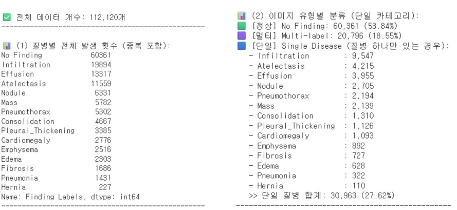
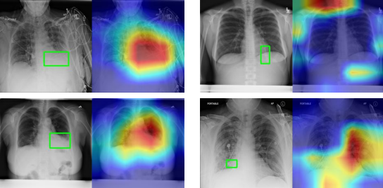
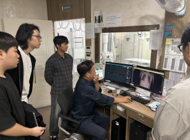
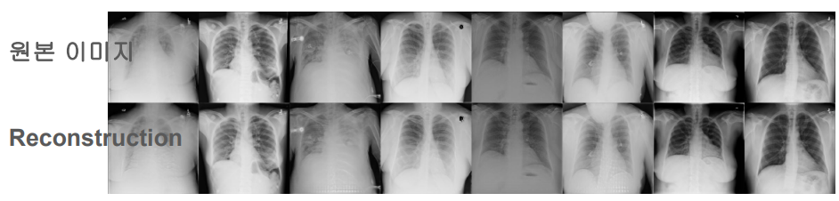
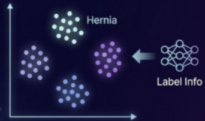
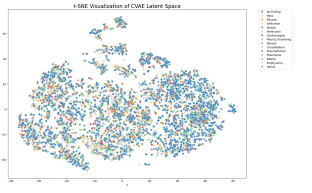

> **한 줄 요약**
> "NIH Chest X-ray 데이터의 극심한 불균형(Hernia 0.2%)을 CVAE 및 Latent Diffusion 기반 데이터 생성으로 해결하고자 했으나, 절대적 데이터 모수 부족과 임상적 유효성 검증의 벽에 부딪혀 프로젝트를 중단하며 배운 엔지니어링 실패 회고"

---

## 1. 발단: 0.2%의 벽과 나이브했던 접근

NIH Chest X-ray 14 데이터셋을 처음 열어보았을 때 마주한 숫자는 생각보다 훨씬 가혹했다. 

총 112,120장의 대규모 흉부 X-ray 데이터 중 정상(No Finding)이 60,361장으로 전체의 **53.84%**를 차지했다. 반면 14개 질환 중 가장 발생 빈도가 높은 침윤(Infiltration)은 약 2만 장에 달했지만, 탈장(Hernia)은 고작 **227장(전체의 약 0.2%)**에 불과했다. 다수 클래스와 소수 클래스 간의 데이터 격차가 무려 100배에 달했다.

```text
[NIH Dataset Class Distribution]
- No Finding (정상)     : 60,361장 (53.84%)
- Infiltration (침윤)   : 19,894장 (17.74%)
...
- Hernia (탈장)         :    227장 ( 0.20%)
```

이 환경에서 분류 모델이 모든 입력을 '정상'이라고 찍기만 해도 단순 정확도(Accuracy)는 54%가 나온다. 모델 학습을 시작하자마자 네트워크는 200장 남짓한 Hernia를 완벽히 포기하는 방향으로 수렴했다. 소수 클래스를 완전히 무시하고 다수 클래스에만 가중치를 몰아주는 것이 전체 손실(Loss)을 줄이는 데 훨씬 유리했기 때문이다.

초기에는 이미지 분류에서 널리 쓰이는 DenseNet을 베이스라인으로 잡고, 고전적인 컴퓨터 비전 데이터 증강(Augmentation) 기법을 시도했다. 하지만 회전(Rotation), 좌우 반전(Flip), 무작위 왜곡을 가할수록 모델의 성능은 오히려 불안정해졌다. 

흉부 X-ray는 사물의 각도가 자유로운 일반 이미지(자연물, 차량 등)와 완전히 다르다. 인간의 신체 장기와 뼈대(Bone structure)는 해부학적으로 엄격하게 고정된 **낮은 차원의 매니폴드(Manifold)** 위에 존재한다. 심장의 위치, 갈비뼈의 각도, 횡격막의 경계선이 조금만 뒤틀려도 컴퓨터는 인간의 흉부가 아닌 '비현실적인 괴물 데이터'를 보게 된다. 나이브한 기하학적 증강은 데이터의 다양성을 높여주기는커녕 모델의 표현(Representation)만 깨뜨릴 뿐이었다.

---

## 2. 가설의 전환: "그렇다면 인공지능이 병을 직접 그리게 하자"

기존 데이터를 억지로 비트는 방식이 통하지 않자, 다른 돌파구가 필요했다. 도메인 지식을 얻기 위해 예수병원 영상의학과 전문의 미팅에 참여했을 때, 교수님께서 던져주신 말씀이 머리를 쳤다.

> *"비슷한 질병을 감별하는 힘은 병을 많이 봐서가 아니라, 정상적인 상태를 셀 수 없이 많이 본 경험에서 나옵니다."*
> *"의료 영상에서 중요한 건 애매한 확률로 병을 맞히는 것보다, 멀쩡한 사람을 환자로 오진하지 않는 신뢰성입니다."*

이 조언에서 착안해 한 가지 가설을 세웠다.

> **가설(Hypothesis):**  
> "인간의 정상 흉부 골격 구조는 공통적이므로, 모델이 정상적인 해부학적 매니폴드(Bone structure)를 안정적으로 학습하게 한 뒤, 그 위에 소수 질환(Hernia 등)의 병변 특징만 조건(Condition)으로 입혀서 새로운 이미지를 생성(Synthesis)해내면 부족한 200장의 한계를 뚫고 학습 데이터를 증강할 수 있지 않을까?"

즉, 분류 문제를 풀기 전에 **조건부 생성 모델(Conditional Generative Model)**을 먼저 구축해 불균형을 데이터 레벨에서 원천 해결하겠다는 계획이었다.

---

## 3. 기술적 시도: CVAE와 Latent Diffusion Model (LDM)

$1024 \times 1024$의 초고해상도 의료 영상을 픽셀 단위에서 직접 확산(Diffusion)시키는 것은 학습 비용과 연산량 관점에서 무모했다. 따라서 2단계 압축 파이프라인을 설계했다.

1. **Spatial Latent Compression (CVAE):**  
   완전 연결 계층(Dense Layer)으로 1차원 벡터를 뽑아내는 대신, 해부학적 위치 정보를 유지하기 위해 잠재 공간을 $(H, W, C)$ 형태의 3차원 공간 텐서로 정의했다. 여기에 라벨 정보(Label Condition)를 주입해 특정 질환의 발현을 조건화했다.
2. **Latent Diffusion (LDM):**  
   VAE의 고유한 한계인 흐릿한(Blurry) 복원 결과물을 극복하기 위해, 압축된 잠재 공간 내부에서 점진적으로 노이즈를 제거하며 디테일을 살리는 확산 모델을 얹어 고해상도 X-ray를 복원하고자 했다.

우선 19 에포크 시점까지 복원(Reconstruction) 성능을 끌어올리며 그럴듯한 뼈대와 폐 음영이 잠재 공간에서 복원되는 것을 확인했다. 이때까지만 해도 이 생성 파이프라인이 소수 클래스의 구원투수가 될 줄 알았다.

---

## 4. 직면한 균열과 실패 원인 분석 (Post-Mortem)

하지만 모델을 발전시키고 결과를 검증하려던 순간, 프로젝트는 심각한 논리적 모순과 기술적 한계에 부딪혔다.

### 1) '생성 모델의 역설' - 200장으로 생성 모델을 학습시킨다는 모순
가장 근본적인 실패 요인은 데이터의 절대적 모수 부족이었다.  
생성 모델은 단순히 경계선을 긋는 분류(Classification) 모델보다 데이터의 전체 확률 분포 $p(x)$를 추정해야 하므로 **훨씬 더 방대한 양의 데이터를 필요로 한다.** 

그런데 200장밖에 없어서 분류를 못 하겠다는 문제를 해결하기 위해, 200장짜리 질환을 학습하는 생성 모델을 만들겠다는 발상 자체가 거대한 방법론적 모순이었다. 모델은 Hernia의 다양한 병리학적 스펙트럼을 학습한 것이 아니라, 그 227장 환자들의 특이한 체형과 촬영 노이즈를 달달 외우고 있었을 뿐이었다.

### 2) t-SNE 시각화의 자의적 해석과 인지 편향
CVAE의 잠재 공간(Latent Space)을 2차원으로 축소해 t-SNE로 시각화했을 때, 기대와 완전히 다른 그림이 나왔다.

* **초기 기대:** 잠재 공간 상에서 Hernia 데이터들이 한구석에 예쁘게 뭉쳐(Clustering) 있을 것이라 생각했다.


* **실제 결과:** Hernia 데이터들이 전체 잠재 공간에 걸쳐 무작위로 흩뿌려져(Scattered) 다른 클래스들과 완전히 뒤섞여 있었다.

```text
[당시의 뇌피셜(Rationalization)]
"라벨 정보를 이미 조건으로 넘겨줬으니, 잠재 변수 z는 질병 정보를 담을 필요가 없어져 순수한 '환자의 해부학적 체형'만 담게 된 것이다! 
그러니 임의의 환자 체형 벡터에 Hernia 조건만 더하면 무한한 탈장 이미지를 뽑아낼 수 있다!"
```

당시에는 이 결과를 이렇게 해석하며 일종의 '의미론적 분리(Disentanglement)'가 일어났다고 합리화했다. 하지만 냉정하게 돌아보면 이는 완전히 틀린 해석이었다.

**t-SNE는 고차원 비선형 관계를 2차원 평면으로 억지 투영하는 시각화 도구일 뿐, 그것이 잠재 공간의 수학적 독립성이나 의미론적 분리를 입증하는 근거가 될 수 없다.** 

실제로는 모델이 라벨 정보와 이미지 특징을 깔끔하게 분리해낸 것이 아니라, 소수 클래스의 특징 벡터를 제대로 학습하지 못해 잠재 공간 전체에 노이즈처럼 흩뿌려진 것에 가까웠다. 보고 싶은 것만 보려 했던 전형적인 확증 편향이었다.

### 3) 외부 데이터 교차 검증에서 드러난 도메인 갭(Domain Shift)
생성된 데이터의 유효성을 간접적으로 확인해 보고자, Roboflow에서 수집한 외부 Hernia 데이터(482장)로 별도의 'Specialist 판별기'를 학습시켰다. 외부 데이터셋에서는 `val_auc: 1.0`이 찍히며 완벽하게 분류하는 듯했다(이것 역시 데이터 중복과 누수로 인한 명백한 과적합이었다).

이 Specialist 모델을 NIH 원본 Hernia 227장에 들이댔을 때 처참한 결과가 나왔다.

* 예측 확률이 0.8~1.0 구간으로 확실하게 나오는 케이스는 거의 없었다.
* 대부분의 데이터가 $0.4 \sim 0.6$ 구간, 즉 모델이 "이게 탈장인지 아닌지 도저히 모르겠다"며 동전 던지기를 하는 회색 지대에 몰려 정규분포를 그렸다.

병원마다 사용하는 X-ray 기기의 센서, 방사선 조사량, 후처리 알고리즘이 다르기 때문에 발생하는 **도메인 갭(Domain Shift)**을 전혀 극복하지 못한 결과였다. 외부 데이터로 학습한 판별기조차 NIH의 원본 탈장을 알아보지 못하는데, 이 판별기로 합성된 이미지의 유효성을 검증하겠다는 계획은 완전히 모래성 위에 지은 집이었다.

### 4) 가장 치명적인 병목: "이게 진짜 병이 맞습니까?" (임상적 검증의 부재)
결국 프로젝트의 숨통을 끊은 질문은 이것이었다.  
**"AI가 생성해낸 흑백 음영이, 실제 의사가 봤을 때 '탈장 병변'이라고 인정할 수 있는 유효한 데이터인가?"**

자연어 처리의 문법 오류나 일반 이미지 생성의 어색한 손가락은 개발자가 육안으로 보고 걸러낼 수 있다. 하지만 의료 영상은 달랐다. 횡격막 위로 장기가 밀고 올라온 음영인지, 촬영 시 숨을 덜 들이마셔서 생긴 횡격막 거상인지, 아니면 확산 모델이 무작위 노이즈를 지우다가 만들어낸 인공적인 결함(Artifact)인지 우리 팀 중 그 누구도 판별할 수 없었다.

의료진의 정성적 블라인드 테스트나 실제 임상 판독 장비와의 연동 검증 파이프라인을 구축하지 못한 상태에서, 합성된 이미지를 분류 모델의 학습 셋에 집어넣는 것은 모델에게 '정교한 거짓말(환각)'을 정답이라고 가르치는 꼴이었다.

결국 "우리가 만든 생성 데이터의 안전성을 입증할 방법이 없다"는 결론에 이르렀고, 프로젝트는 유의미한 수치를 남기지 못한 채 흐지부지 중단되었다.

---

## 5. 실패를 통해 배운 4가지 엔지니어링 교훈

이 프로젝트는 깃허브에 화려한 메트릭 그래프 하나 남기지 못한 실패작이다. 하지만 연구실 밖의 현실 데이터를 다루는 엔지니어로서 어떤 태도를 가져야 하는지 가장 뼈아프게 깨달은 경험이었다.

### 1. 생성 모델은 데이터 불균형의 만능 열쇠가 아니다
데이터가 부족할 때 생성 모델을 떠올리는 것은 대단히 위험한 접근이다. 생성 태스크는 분류 태스크보다 훨씬 더 많은 데이터와 정밀한 분포 추정을 요구한다. 적은 데이터로 인해 분류가 안 되는 상황에서, 그 적은 데이터로 생성을 먼저 하겠다는 것은 문제를 더 복잡한 미로 속으로 끌고 들어가는 일이었다.

### 2. 시각화 툴(t-SNE)에 희망 섞인 가설을 투영하지 말 것
2차원 투영 시각화는 데이터의 대략적인 분포를 훑어보는 보조 지표일 뿐, 알고리즘의 유효성을 증명하는 수학적 증거가 될 수 없다. 잠재 공간의 분리(Disentanglement)를 주장하려면 상호정보량(Mutual Information) 측정이나 체계적인 잠재 축 조작(Latent Traversal) 같은 정량적 검증이 선행되었어야 했다.

### 3. 도메인 전문가의 검증 루프 없는 의료 AI는 허상이다
모델의 Loss나 FID(Fréchet Inception Distance) 같은 수치가 아무리 좋아도, 실제 임상 현장의 전문가가 병리학적 유효성을 보증하지 못하는 데이터는 의료 도메인에서 1g의 가치도 없다. 문제를 정의하는 순간부터 '최종 검증을 누구에게 어떤 기준으로 받을 것인가'가 시스템 파이프라인에 포함되어 있어야 했다.

### 4. 만약 지금 이 프로젝트를 다시 시작한다면?
다시 그 시점으로 돌아간다면, 화려한 생성 모델이라는 유행을 즉시 걷어내고 철저히 **데이터 중심(Data-Centric)** 및 **손실 함수(Loss) 기반의 엔지니어링**에 집중할 것이다.

1. **극단적 불균형에 특화된 목적 함수 도입:**  
   소수 클래스에 페널티를 강하게 주는 Class-Balanced Focal Loss나, 유효 샘플 수(Effective Number of Samples) 기반 가중치 손실 함수를 우선 적용한다.
2. **도메인 특화 사전학습 백본 활용:**  
   자연물 데이터(ImageNet)로 학습된 가중치가 아니라, 대규모 의료 영상으로 사전 학습된 가중치(RadImageNet, CheXNet 등)를 백본으로 삼아 소수 클래스 특징 추출 능력을 극대화한다.
3. **Stage-1 (선별) $\to$ Stage-2 (정밀 감별) 계층적 파이프라인:**  
   처음부터 14개 질환을 한 번에 다중 라벨링하려 하지 않고, 1단계에서 정상과 비정상을 보수적(High Recall)으로 걸러낸 뒤, 2단계에서 의심 환자군에 대해 소수 질환 전문 판별기를 태우는 파이프라인으로 쪼개어 접근했을 것이다.

---

## 맺음말:

프로젝트가 실패를 거듭하며 중단되었을 때, 솔직히 제대로 된 결과물도 없고, 멘토링에서 지적받은 한계를 온전히 해결하지도 못해서 많이 아쉬웠다.

하지만 이 실패를 복기하는 과정에서 내가 무엇을 몰랐는지, 복잡한 최신 딥러닝 기법이라는 환상 뒤에 숨겨진 현실 데이터의 제약이 얼마나 무거운지를 비로소 객관적으로 마주할 수 있었다.

겸손하자. 최신 기술들은 과거의 이론에서부터 비롯되었다. 그럼 우선순위는 자명하